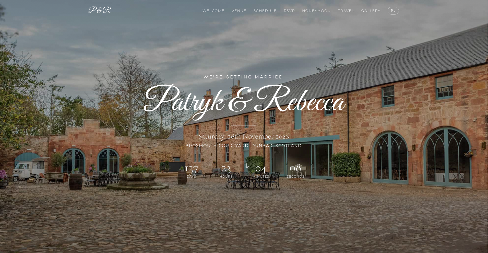
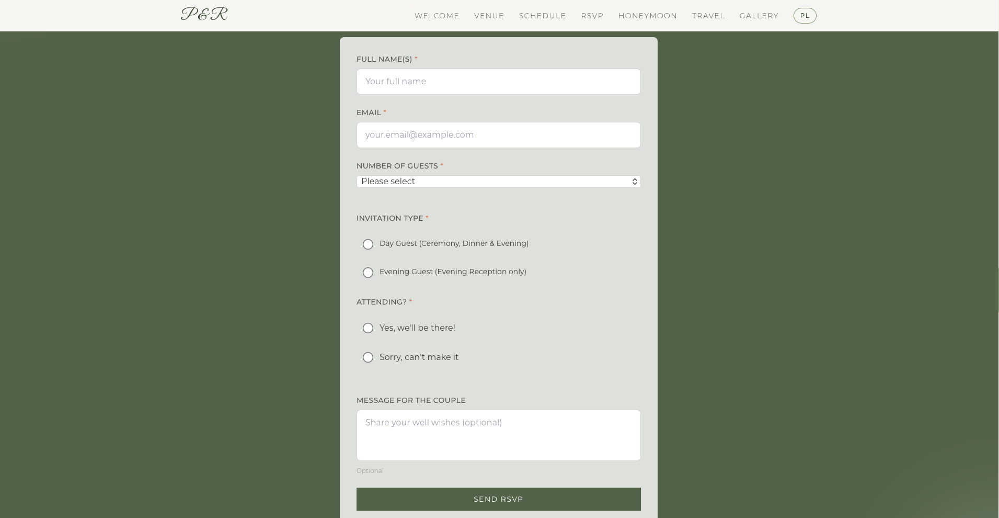

# Wedding Website 

A bilingual (EN/PL) wedding platform built with Next.js and Firebase — live in production, serving 110+ guests with RSVP collection and a real-time admin dashboard.

**Live site:** [https://patrykbecca.vercel.app] *(password-protected for guests)*

## Screenshots

**Homepage**


**RSVP Form**


## Features

- **RSVP form** — guest names, email, party size, invitation type (day/evening guest), attendance, dietary requirements, toast preference, and a message for the couple — all with client-side validation
- **Bilingual support** — full English/Polish content switching via a language context
- **Admin dashboard** — Firebase Authentication–protected, with a real-time guest list (Firestore listeners), search, filtering by attendance and invitation type, column sorting, and one-click CSV export
- **Two site versions** — full-day wedding or evening-only reception, toggled by a single environment variable, each with a tailored schedule and RSVP form
- **Password gate** — simple access gate so the site isn't publicly browsable
- **Calendar downloads** — .ics files so guests can add the events straight to their calendar
- **Content sections** — venue, schedule, travel info, gallery, and honeymoon fund

## Tech Stack

- **Frontend:** Next.js 14 (App Router), TypeScript, Tailwind CSS
- **Backend:** Firebase (Firestore, Authentication)
- **Deployment:** Vercel

## Security

- Firestore Security Rules validate all RSVP submissions server-side (required fields, correct types)
- Guest data reads are restricted to authenticated users only — enforced at the database level, not the frontend
- Admin dashboard is protected by Firebase Authentication (email/password)
- Updates and deletes on RSVP records are disabled entirely in the rules

## Getting Started

1. Clone the repo
2. Copy `.env.local.example` to `.env.local` and fill in your Firebase project credentials
3. Install dependencies:

```bash
   npm install
```

4. Run the dev server:

```bash
   npm run dev
```

5. Open [http://localhost:3000](http://localhost:3000)

## Project Structure

- `src/app` — App Router pages (public site + `/admin` dashboard)
- `src/components` — Hero, RSVP form, schedule, venue, gallery, and other UI sections
- `src/lib` — Firebase client config, language context, translations, site version logic
